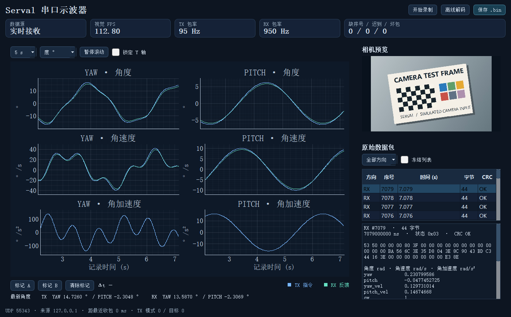

# Serval 功能与原理

Serval 用于实时查看串口收发波形、数据包和视觉帧率。Jetson 和 Windows 各有独立的原生窗口，网页端也支持离线回放。安装、编译和各入口的启动命令见 [运行指令](../README.md#2-原生窗口直接显示在-orin)。

## 界面速览

以下截图由当前程序使用模拟串口数据和相机测试图卡生成。图中的帧率、包率和波形用于展示界面。

### Jetson 调试版：相机与波形同屏

`standard_debug_mpc` 的右上角显示相机取景，右下角显示原始数据包和解析字段。顶部「视觉 FPS」对应视觉主循环，预览区标题上的 `实际 / 目标 FPS` 对应该画面的更新频率。预览默认目标为 60 FPS，最高可设为 120 FPS，实际读数取决于相机供帧和 Jetson 负载。



### Jetson 标准版：波形和包详情

`standard_mpc` 将右侧空间留给串口包列表和详情。把鼠标移到波形上可读取对应时刻的样本。标记 A、B 后，底部显示两个时间位置的差值。包列表可按 TX、RX 筛选或冻结，选中一行可复制 HEX 并查看 CRC 与解析字段。顶部「开始录制」持续写入之后收到的包。


### Windows 接收窗口

Windows 接收端通过局域网 UDP 获取 Jetson 的观测数据。界面显示六张波形、视觉 FPS、TX/RX 包率，以及最新两方向的 HEX。顶部按钮可暂停曲线、调整显示范围和保存最近的数据包缓存。


### 离线解码窗口

Jetson 可从实时窗口打开，Windows 可单独运行 `save/offline_decode.py`。点击「启动解码」后，左侧显示记录统计和拒收原因，右侧预览生成的波形图。


### 网页端

浏览器可以查看实时波形、原始包和控制诊断，也可以打开已有的 `.bin` 记录回放。网页支持下载原始包和导出解析 CSV。

## 两种显示方式

| 项目 | 原生示波器 | 网页示波器 |
| --- | --- | --- |
| 显示程序 | Jetson 使用 `jetson_scope.py`，Windows 使用 `native_scope.py` | 浏览器 |
| 启动器 | `native_watch.py` | `orin_watch.py` |
| 数据来源 | 自瞄后台直接发送 UDP | 读取自瞄录制的 `.bin` 文件 |
| 传输 | Orin 本机回环，或直接发到电脑 IP | HTTP，必要时通过 SSH 转发 |
| 启动时是否必须有浏览器 | 否 | 显示页面需要浏览器 |
| 完整原始录制 | 使用 `--record` 可选开启 | 联合启动脚本默认开启 |
| 适用 | 实时观察指令和反馈 | 离线回放、字段详细解析、误差/阶跃分析 |

原生窗口可直接运行在有图形桌面的 Orin，也可运行在 Windows。只向 Windows 发送数据的 Orin 不需要图形桌面。
两台机器要网络互通。校园网或访客网络可能限制终端之间的 UDP，换同一路由器或直连网线后再测试。
首次安装依赖需要网络；依赖安装完成后可在无互联网的局域网使用。

## 为什么旧显示会一跳一跳

网页模式的串口记录约每 200 ms 刷新到文件，监听器随后读取，浏览器再定期请求并绘图。
这些环节可能使多帧一次出现。SSH 隧道、网络抖动、Orin 的计算/磁盘负载也可能增加显示等待，
但不能把所有延迟都归因于 SSH。终端刷屏流畅程度也不等于真实串口控制周期。

原生模式直接从自瞄记录器的后台队列发送 UDP，不等待日志落盘，不经过 HTTP 轮询或 SSH 隧道。
接收线程解析数据，图形主线程默认每秒尝试刷新 30 次，可用 `--refresh 60` 请求 60 次。
刷新目标不是实测保证，CPU/GPU、系统调度和网络仍可能导致抖动。

这消除了旧路径中约 200 ms 的固定批量刷新等待，但没有宣称“端到端延迟为 0”或“保证某毫秒”。
窗口的“距收包”只表示电脑最近收到包距现在多久，不是 Orin 到电脑的单程延迟。
主机时钟未同步且协议没有设备时间回显时，不能精确测量单程传输延迟。

## 原生链路与对控制的影响

```text
相机 → 自瞄算法 → 实际串口 → 云台
                  ↓ 原始 TX/RX 复制入队
             记录器后台线程
                  ↓ UDP
          原生窗口接收线程 → 固定刷新绘图
```

`SP_SERIAL_UDP=目标IPv4:端口` 开启观测。没有设置时不创建网络发送端。
原始数据在现有记录队列中复制、入队，后台线程执行非阻塞 UDP 发送。
队列满时丢弃观测记录；UDP 发送失败时不等待接收者、不重发控制命令。
监视器不占用真实串口，不生成云台运动或开火命令，不改 PID、标定、敌方颜色或 YAML。

关闭原生窗口不会关闭自瞄。对 `native_watch.py` 按 Ctrl+C 会停止它启动的自瞄和本地窗口。
远端窗口不受 Orin 启动器管理。选择 `nohup` 后，关闭终端也不停止自瞄，需主动结束进程。

监视并非零开销：复制、锁、线程调度、网络及绘图都消耗资源。
原生启动器默认关闭串口落盘，设 `SP_LOG_LEVEL=info` 以屏蔽高频 debug 计时输出，
保留正常信息、警告、错误和每秒 FPS。加 `--record` 后仍会写完整原始日志，慢磁盘可能拖慢后台观测。
真实控制线程不直接进行网络/磁盘 I/O，但不能保证系统整体负载对自瞄完全无影响。

## 原生窗口各项含义

| 模块 | 含义 |
| --- | --- |
| 视觉 FPS | 原 `standard_mpc` 每秒输出的主循环平均帧率，包含取帧和处理等待；不是 RX/TX 频率 |
| TX / RX Hz | 接收端最近一秒收到的各方向观测记录数；受 UDP 丢包和调度影响 |
| 六张曲线 | Yaw/Pitch 角度、角速度、TX 角加速度；蓝色为 TX，绿色为 RX |
| Jetson 同步游标 | 六张图使用同一时间位置，读出游标左侧的最近样本及样本年龄 |
| Jetson A/B 标记 | 将游标所在位置设为 A 或 B，显示 B−A 的时间差 |
| Jetson 包详情 | 同屏查看最近 60 条记录，可按 TX/RX 筛选、冻结列表并复制 HEX |
| Jetson 相机预览 | `--binary standard_debug_mpc` 显示该进程采到的原始画面。默认目标 60 FPS，`--preview-fps` 可设为 1～120。标题栏显示实收帧率与目标帧率 |
| mode / 目标 | 最新有效 TX 的控制模式和目标 ID |
| 缺序号 | 观测记录序号缺口，可来自发送端观测队列或网络丢包，不等于串口线路丢包 |
| 迟到 | 重复或倒序到达的观测记录；忽略以免曲线时间倒退 |
| 坏包 | CRC、记录状态、协议方向或有限数值检查失败；原始记录仍可保存 |
| 距收包 | 接收端本地的新鲜度；超过一秒没有观测包会显示过期 |
| 暂停显示 | 冻结曲线，底层仍接收；不暂停自瞄 |
| 锁定 Y 轴 | 固定当前纵轴范围，便于比较两次调参，不改变数据 |
| 保存当前缓存 | 保存最近最多 60000 个原始记录，含坏包；不能替代完整录制 |
| Jetson 开始 / 停止录制 | 后台持续写入界面收到的原始 RMSE 记录，保留时间戳、方向、序号和记录状态。停止后显示路径、已写入包数和写入队列丢弃数 |

两方向用 Orin 同一个记录器的相对时间轴，不用网络到达时刻作为曲线横坐标。
新进程会生成新会话，接收端清空旧曲线，避免把两个实验连接在一起。
默认只接受首先收到有效观测包的来源 IP；可用 `--source-ip` 固定 Orin 的 IP。

## 精度与曲线

严格按工程小端 packed 协议解析 float32。Python 浮点可精确容纳有限 float32；显示为度仅做单位换算。
不对原始数据滤波、平滑或移位，不把时序对齐“修饰”成更好看的响应。
TX 用阶梯显示；RX 在真实采样点之间连线。丢包、超过 100 ms 的时间空档、TX 模式切换和角度跨 ±π 时断线。
Windows 窗口的密集曲线使用 PyQtGraph 峰值降采样显示。Jetson 根据原始样本绘图，状态和列表独立刷新。

真正的目标切换、控制模式变化或传感器跳变仍然会显示。若原始包本身有跃变，显示优化不会替你消掉它。
比较目标和反馈前必须确认上下位机的坐标系、符号、零点和单位一致。
RX 未提供角加速度，不用数值差分冒充实际反馈加速度。

## 串口包

帧头 `53 50`（`SP`），CRC16 初值 `0xffff`，反射多项式 `0x8408`，低字节先传，无最终异或。

| 方向 | 总长度 | 字段起始偏移（从 0 计数） |
| --- | --- | --- |
| TX | 30 字节 | mode:2, yaw:3, yaw_vel:7, yaw_acc:11, pitch:15, pitch_vel:19, pitch_acc:23, target_id:27, CRC:28 |
| RX | 44 字节 | mode:2, qw/qx/qy/qz:3/7/11/15, yaw:19, yaw_vel:23, pitch:27, pitch_vel:31, bullet_speed:35, bullet_count:39, enemy_color:41, CRC:42 |

角度是 rad、角速度 rad/s、加速度 rad/s²；弹速 m/s，发弹数 uint16，模式/目标/颜色 uint8。
TX mode=0 不控制，1 控制但不开火，2 控制且允许开火；RX mode=1 表示反馈自瞄模式，两者含义不同。
工程默认颜色 0 蓝、1 红。TX 校验正确只证明观测到的包完整，不能证明云台实际执行。

## 网络观测包与记录文件

UDP 观测包采用 `SVL1 + uint64会话ID + 若干RMSE记录`，每个网络包最多 1200 字节。
每条记录保留原始串口负载、方向、状态、每方向序号和 Orin 记录时间。与串口线上协议不同，不要求电控修改。
视觉 FPS 使用独立 `SVF1 + float64` 观测包，超过三秒没更新时不显示旧值。
UDP 不保证送达和顺序，因此长期证据建议使用 Orin `--record` 录制。

`.bin` 是原有 RMSE 格式：24 字节记录头加原始串口负载。头结构为 `<IBBHQII`。
Jetson 顶部的「离线解码」会打开独立窗口。选中 `.bin` 后点「启动解码」，结果 `tx.csv` 和 `rx.csv` 保存在记录旁的新目录。安装 Matplotlib 后可以生成并预览波形 PNG。网页也可以读取 `.bin` 回放。

离线和实时窗口共用串口字段、CRC 和记录状态校验。CSV 保留 `time_ns`、原序号、状态和 HEX，拒收记录通过 `valid` 和 `reject_reason` 标记，数值列留空。波形在缺样或拒收段断开。发送进程重启时，GUI 结束当前录制文件，避免混入另一会话的时间基准。

完整操作和命令见 [GUI 录制与离线解码](../README.md#9-gui-录制与离线解码)。
新会话会清空接收缓存，点击保存只能导出当前会话最近记录，不能追回此前丢失的数据。

## 文件分工

| 文件 | 职责 |
| --- | --- |
| `jetson_scope.py / lib/jetson_window.py` | Jetson 单页波形、游标、包详情和相机预览 |
| `native_scope.py` | Windows 接收窗口 |
| `lib/live_udp.py` | UDP 接收、会话/序号管理、缓存和解码 |
| `native_watch.py` | 启动自瞄，可选本地窗口，传送 FPS，管理退出 |
| `io/gimbal/serial_recorder.*` | 实际串口观测数据入队、后台 UDP 和可选原始录制 |
| `lib/protocol.py` | 原有串口布局、CRC、原始数值解析 |
| `save/offline_decode.py` | 独立离线窗口、解码按钮和结果预览 |
| `save/decode_serial_log.py` | 离线读取 RMSE、输出 CSV 与波形图 |
| `orin_watch.py / monitor.py` | 原有网页启动器/服务，继续保留 |
| `web/` | 网页界面、样式和绘图脚本 |

已做 Windows Qt 窗口测试、Linux 模拟进程生命周期测试及实际 C++ 记录器到 Python 的 UDP 解码测试。
完整视觉工程仍需在 Orin 编译；尚未在你的真实 Orin 和云台上测得新增开销或端到端延迟。
