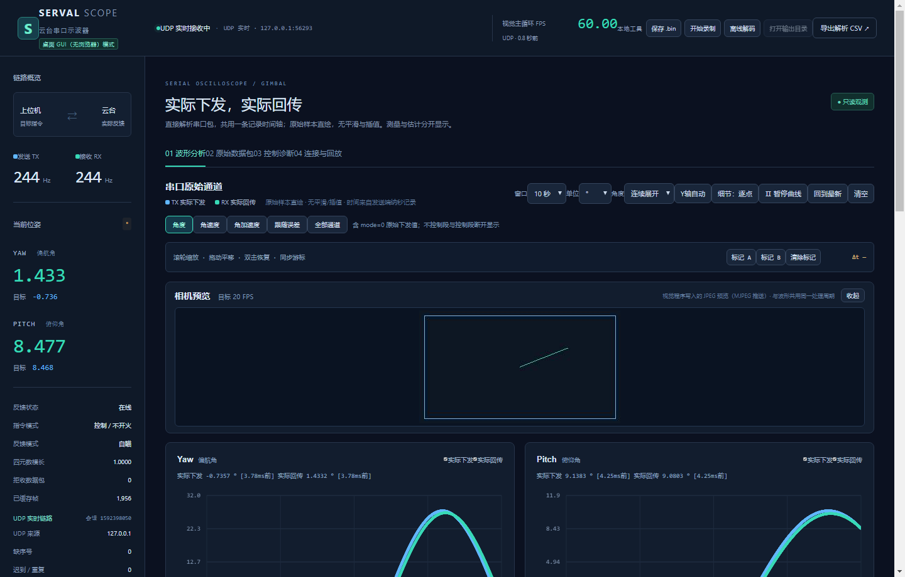
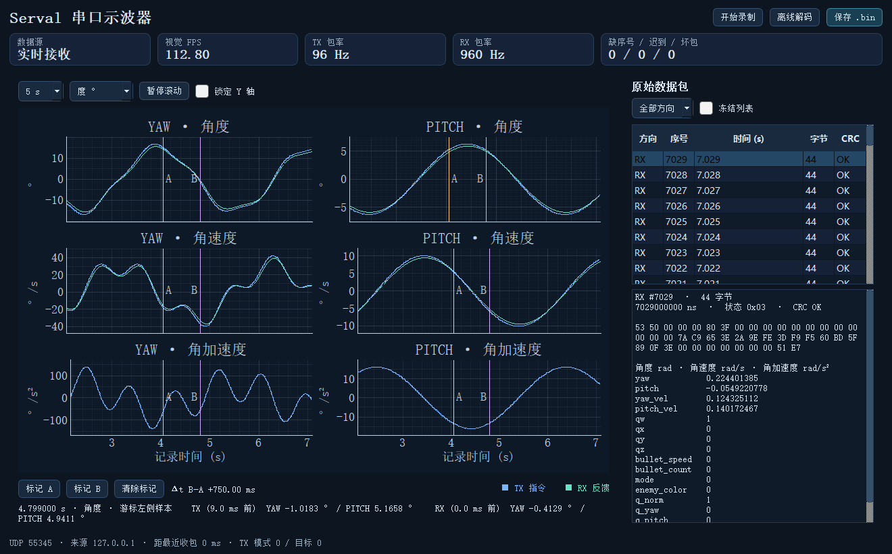
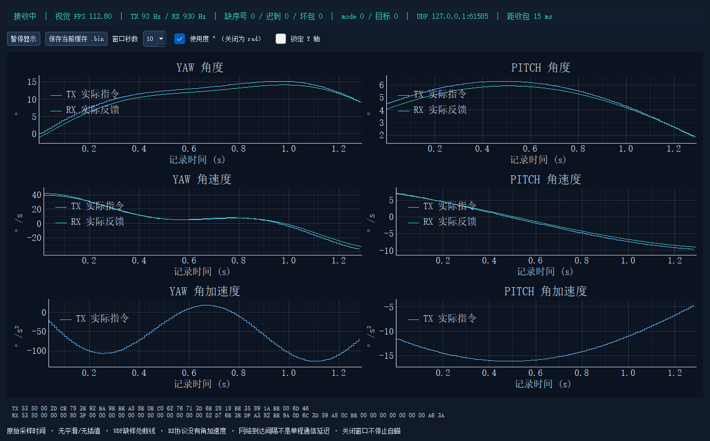
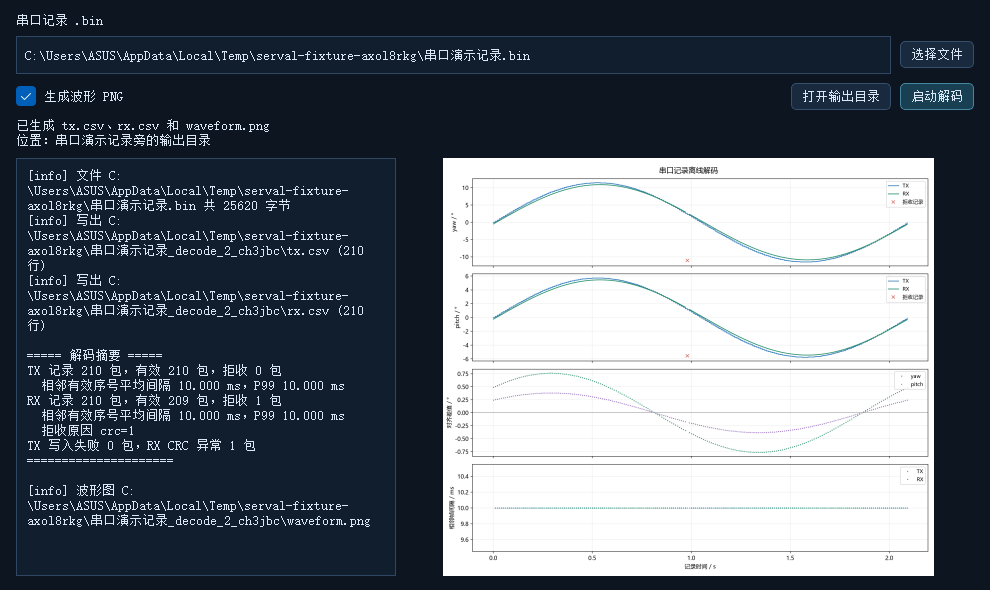
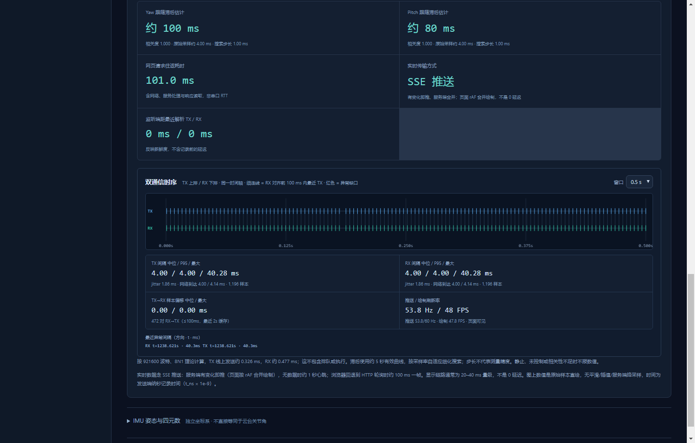

# Serval 功能与原理

本文只说明 Serval 的功能、数据通路、界面含义、精度/延迟边界和实测数据；**安装、启动、停止和开发验证命令见
[运行指令](../README.md)**（`tools/serval/README.md`）。两者分工：README 只保留通用指令，本文负责说明。

Serval 用于实时查看串口收发波形、数据包和视觉帧率。Jetson 和 Windows 均可使用**桌面 GUI 页面模式**（QtWebEngine 内嵌网页，不需要浏览器），
旧的 PyQtGraph 原生窗口（经典模式）和浏览器网页模式继续保留。

## 目录

- [界面速览](#界面速览)
- [三种显示方式](#三种显示方式)
- [Linux → Windows 二进制直发（低算力模式）](#linux--windows-二进制直发低算力模式)
- [桌面 GUI 页面模式](#桌面-gui-页面模式)
- [高频采集、双通信比对与细节诊断](#高频采集双通信比对与细节诊断)
- [为什么旧显示会一跳一跳](#为什么旧显示会一跳一跳)
- [观测链路与对控制的影响](#观测链路与对控制的影响)
- [显示窗口各项含义](#显示窗口各项含义)
- [精度与曲线](#精度与曲线)
- [串口包](#串口包)
- [网络观测包与记录文件](#网络观测包与记录文件)
- [文件分工](#文件分工)

## 界面速览

以下截图由当前程序使用模拟串口数据和相机测试图卡生成。图中的帧率、包率和波形用于展示界面。

### 桌面 GUI 页面（Jetson / Windows 双版本）

QtWebEngine 原生窗口内嵌与浏览器相同的页面。页面顶部「本地工具」提供保存 `.bin`、开始/停止录制、离线解码和打开输出目录；
侧栏显示 UDP 实时链路计数；带相机的调试版会在波形上方显示 MJPEG 预览。下图为合成 UDP 数据 + 合成相机画面：
发送端时间轴从 1238 s 附近开始（模拟视觉进程已运行一段时间），窗口内显示的是发送端记录时间，不是本机时钟。



### Jetson 调试版：相机与波形同屏

`standard_debug_mpc` 的右上角显示相机取景，右下角显示原始数据包和解析字段。顶部「视觉 FPS」对应视觉主循环，预览区标题上的 `实际 / 目标 FPS` 对应该画面的更新频率。预览默认目标为 60 FPS，最高可设为 120 FPS，实际读数取决于相机供帧和 Jetson 负载。


### Jetson 标准版：波形和包详情

`standard_mpc` 将右侧空间留给串口包列表和详情。把鼠标移到波形上可读取对应时刻的样本。标记 A、B 后，底部显示两个时间位置的差值。包列表可按 TX、RX 筛选或冻结，选中一行可复制 HEX 并查看 CRC 与解析字段。顶部「开始录制」持续写入之后收到的包。



### Windows 接收窗口

Windows 接收端通过局域网 UDP 获取 Jetson 的观测数据。界面显示六张波形、视觉 FPS、TX/RX 包率，以及最新两方向的 HEX。顶部按钮可暂停曲线、调整显示范围和保存最近的数据包缓存。



### 离线解码窗口

Jetson 可从实时窗口打开，Windows 可单独运行 `save/offline_decode.py`。点击「启动解码」后，左侧显示记录统计和拒收原因，右侧预览生成的波形图。



### 网页端

浏览器可以查看实时波形、原始包和控制诊断，也可以打开已有的 `.bin` 记录回放。网页支持下载原始包和导出解析 CSV。

## 三种显示方式

| 项目 | 桌面 GUI 页面（推荐） | 经典原生示波器 | 网页示波器 |
| --- | --- | --- | --- |
| 显示程序 | `windows/windows_gui.py` / `linux/jetson_gui.py` 内嵌 `web/` 页面（QtWebEngine） | Windows `windows/native_scope.py`，Jetson `linux/jetson_scope.py` | 浏览器 |
| 启动器 | Windows 接收端 + Jetson `linux/aim_bridge.py`（低算力直发）或本机 GUI | `linux/native_watch.py` | `linux/orin_watch.py` / `monitor.py` |
| 数据来源 | 自瞄后台直接发送二进制 UDP，Windows 内解码 | 自瞄后台直接发送 UDP | 读取自瞄录制的 `.bin` 文件（或 `--udp` 直收） |
| 传输 | UDP 二进制（SVL1 + 原始串口帧），Windows 全解算 | UDP → 固定刷新绘图 | HTTP 轮询 + 日志文件跟随，必要时 SSH 转发 |
| 启动时是否必须有浏览器 | 否 | 否 | 是 |
| 页面能力 | 波形、原始包、诊断、误差/阶跃分析、延迟面板、细节模式、双通信时序、本地工具按钮 | 波形、游标、包详情、录制/离线解码按钮 | 同左列网页能力 + 回放/下载 |
| 完整原始录制 | GUI 内「开始录制」，或发送端 `--record` | GUI 内「开始录制」，或发送端 `--record` | 联合启动脚本默认开启 |
| 适用 | 日常实时调试、Windows 远程观察、高频双通信比对 | 低配机器、习惯旧界面 | 离线回放、字段详细解析、远程/多机查看 |

桌面 GUI 页面可直接运行在有图形桌面的 Orin，也可运行在 Windows；只向 Windows 发送数据的 Orin 不需要图形桌面。
经典原生窗口与桌面 GUI 页面都需要图形桌面。
两台机器要网络互通。校园网或访客网络可能限制终端之间的 UDP，换同一路由器或直连网线后再测试。
首次安装依赖需要网络；依赖安装完成后可在无互联网的局域网使用。

## Linux → Windows 二进制直发（低算力模式）

Orin NX 算力有限，跑 Python 解算/QtWebEngine 容易拖慢甚至影响自瞄。因此主链路采用
**Linux 只复制/广播、Windows 全解算** 的单一直发方案（最低延迟，无中间中继进程）：

```text
Jetson(Linux)                                        Windows
自瞄 standard_mpc/standard_debug_mpc
  └ 现有 C++ SerialRecorder 钩子（底层未改动）
       ├ 串口收发线程：原始 TX/RX 字节 memcpy 入队（不解析）
       └ 后台线程：二进制 UDP（SVL1+RMSE 原始帧） ─────→ windows/windows_gui.py
                                                          ├ CRC16/记录状态校验、协议字段解析
                                                          ├ 会话/序号、时间轴、四元数
                                                          ├ 波形/细节/双通信时序显示
                                                          └ 保存 .bin、录制、离线解码
```

- **Linux 端不做的事**：不解 SP 协议、不算 CRC、不做时间对齐、不绘图、不开 HTTP/SSE 服务；
  唯一额外开销是原有的后台复制/发送线程。启动入口 `linux/aim_bridge.py` 只用标准库。
- **二进制线格式**：`SVL1` + `uint64` 会话 ID + 若干 RMSE 记录（24 字节头：方向/status/长度/
  发送端 `t_ns`/每方向序号），负载是线上原始串口帧（TX 30 / RX 44 字节，含 `SP` 与 CRC16）。
  视觉 FPS 是独立 `SVF1 + float64` 数据报。Windows 端全部解析、逐帧校验。
- **时间戳**：`t_ns` 由 C++ 在串口读写处用 `steady_clock` 记录（帧级时间戳），Windows 用它作为
  曲线/双通信比对的时间轴；到达间隔单独统计网络/调度抖动。不改底层，因此没有额外的“驱动级硬件时间戳”，
  但已保留串口帧级精度。
- **校验**：每帧原始 CRC16 在 Windows 复算；会话 ID + 每方向序号用于去重、缺号、迟到统计；
  UDP 自身校验和之外无额外重传，坏包/丢包在 Windows 页面标出，原始字节仍可保存。
- **单一直发方案的理由**：共享内存/Unix socket 需要改底层或增加中继进程，会多一跳并增加 Linux 负载；
  在“不改底层”的前提下，C++ 记录器直接 UDP 到 Windows 是延迟最低、精度最高的方案。
- **可选本机模式**：没有 Windows 时仍可用 `linux/jetson_gui.py`（QtWebEngine）或
  `linux/native_watch.py` 在 Jetson 本机查看；它会在 Jetson 上跑解算/绘制，Orin NX 上不建议长期使用。
- **保留的启动入口**：`linux/aim_bridge.py` 启动的是原有自瞄二进制，只设置观测环境变量，
  不发送任何串口/云台指令，不修改 YAML 或标定；`--record` 可选写完整原始 `.bin`。

## 桌面 GUI 页面模式

Jetson 与 Windows 共用同一套页面和 Python 后端，只是数据入口不同：

```text
相机 → 自瞄算法 → 实际串口 → 云台
                  ↓ 原始 TX/RX 复制入队
             记录器后台线程
                  ↓ UDP SVL1/SVF1（Jetson 本机回环，或局域网到 Windows）
       Python UdpSource：会话/序号管理 + 协议解码（float32 → 原值）
                  ↓ 精确的发送端纳秒时间轴
       monitor.Store → SSE /api/stream（--push-hz 控制，按变化合并推送）
                  ↓
       QtWebEngine 内嵌页面：rAF 合并绘制（无浏览器进程、无地址栏）
```

- **低延迟**：不再经历“串口记录约 200 ms 刷新到文件 → 监听器读文件 → 浏览器 100 ms 轮询”的固定批量等待。
  数据在 Python 内直接解码，SSE 有变化即推，页面用 `requestAnimationFrame` 合并重绘。
  这只消除了旧网页路径的固定等待；网络、调度、解码和绘制仍然耗时，**不是零延迟，也不保证具体毫秒数**。
- **高精度**：沿用同一套 30/44 字节小端 packed 协议、CRC16 和记录状态校验；时间直接使用发送端 `t_ns`（纳秒）
  换算为 float64 秒，帧时间精确等于 `ns × 1e-9`，与本机开机时长无关；数值保留 float32 原值，不做平滑、插值，
  服务端不做降采样。原始 `.bin` 逐字节保留（含坏包），可被 `save/decode_serial_log.py` 原样解算。
- **本地快捷按钮**：页面顶部「保存 .bin」「开始录制/停止录制」「离线解码」「打开输出目录」。
  离线解码在后台子进程运行，窗口不冻结；浏览器访问时这组按钮不显示，改用网页自带的下载/导出链接。
- **相机预览**：`linux/jetson_gui.py --binary standard_debug_mpc` 时，视觉程序写出的最新 JPEG 由后端以 MJPEG 推送到页面，
  与波形并排显示；`--preview-fps` 控制上限（1～120），面板可用「收起」按钮临时隐藏以换取更大的波形区域。
- **会话切换**：视觉进程重启会产生新的 UDP 会话，接收端清空旧曲线；若正在 GUI 内录制，当前 `.bin` 自动结束，
  不会把两个会话的序号/时间基准混进同一文件，页面录制按钮回到「开始录制」。
- **进程关系**：`linux/jetson_gui.py` 关闭窗口会停止它启动的视觉进程（与旧 `linux/native_watch.py` 的 Ctrl+C 一致）；
  Windows 的 `windows/windows_gui.py` 只停止接收端，不影响 Jetson 上的视觉程序。
- **回退**：缺少 QtWebEngine 时两个入口会打印安装命令并退出，可加 `--classic` 使用旧 PyQtGraph 窗口。

开发机（Windows 11 + PyQtWebEngine/QtWebEngine 5.15.2）用合成 UDP 实测的链路基线：服务端收到数据后 SSE 首事件 < 1 ms；
持续 100 Hz 数据流下推送间隔中位数约 16 ms（合并上限约 60 次/秒，P95 约 30 ms）；页面显示还会叠加 Chromium 绘制耗时。
这些数字用于说明链路结构，不是产品保证值；Jetson/ARM 与真实云台环境需要在对应机器上另行测量。

## 高频采集、双通信比对与细节诊断

串口 100–500 Hz/方向、合计 1000 记录/秒时，Serval 的采集与显示分成三层，必须区分：

| 层 | 由谁决定 | 当前实现 / 实测 |
| --- | --- | --- |
| **采样率**（数据完整性） | 视觉程序串口收发 + `SerialRecorder` 入队 | 全部原始记录旁路复制；Python 侧单次解码（一次 CRC + 一次 unpack），1000 记录/秒实测 0 丢失 |
| **推送率**（数据到页面的频率） | `--push-hz`（auto / 20–240） | auto 跟随屏幕但**上限 60**；显式 120 时实测约 115 事件/秒 |
| **绘制刷新率**（屏幕可见更新） | 显示器 + QtWebEngine 渲染 | QtWebEngine 5.15 实测 rAF ≈ 59.5 FPS（165 Hz 屏也一样）；页面离屏图表跳过、DOM 最多 10 Hz |

因此“高频”指**所有样本都被采集、保存并可逐点查看**，不是把屏幕刷新率调到 500 Hz。超过绘制能力的推送不会增加可见帧数，
但可让读数和细节面板更及时；`--push-hz auto` 默认上限 60 就是为了避免这种无收益的解析开销。

**细节数据从哪来**（`lib/udp_source.py` 的 `detail`）：

- `interval_median/p95/max/jitter`：同一方向相邻**接纳记录**的 `t_ns` 差值（发送端采样节奏），jitter 为相邻间隔的总体标准差。
- `arrival_median/p95/jitter`：同一方向相邻记录的本机到达时间差（网络/调度抖动），与发送端节奏分开显示。
- `gaps`：间隔超过 `max(20 ms, 3×该方向中位间隔)` 的最近事件（方向、发送端 t、ms），页面用红色竖线标出；
  它不仅覆盖“丢包”，也能暴露发送端卡顿或串口调度异常。
- TX→RX 样本偏移：页面把每个 RX 对齐到前 100 ms 内最近的 TX，用于看双通信的先后/延迟关系；
  这是**采样对齐估计**，不是串口往返 RTT（协议没有设备时间回显）。

**页面细节能力**：

- 「细节：逐点」：关闭按像素列的包络降采样，逐样本连线；小窗口/稀疏时画样本点；异常间隔红色竖线阈值在细节模式下
  自适应为 max(5 ms, 3×中位间隔)，比普通模式的 100 ms 更敏感。
- 「双通信时序」：同一时间轴 TX/RX 刻线 + RX→最近 TX 连线，窗口 0.2/0.5/1/2 s；配合下面的间隔统计定位双通信细节。
- 侧栏 UDP 链路计数（缺序号/迟到/非法包/来源）与原始包表同步更新；数据包页在 UDP 模式下 200 ms 刷新。



**低干扰措施与边界**：

- 发送端串口线程只 memcpy + 入队，UDP/磁盘都在后台线程；队列满丢观测，不阻塞控制。
- GUI 端：离屏波形不绘制、文本/DOM 最多 10 Hz、页面隐藏只收数不画、进程优先级默认降到自瞄之下
  （Linux `nice 10`、Windows `BELOW_NORMAL`）。`--no-low-priority` 可关闭。
- QtWebEngine 是独立渲染进程/线程，即使不动串口也会占用 CPU/内存；高频调试建议用不带相机的 `standard_mpc`，
  或降低 `--preview-fps`。开发机 500 Hz/方向实测：页面绘制约 48 FPS，GUI 进程树 CPU 约 1.3（250 Hz）/1.8（500 Hz）个核
  （165 Hz 屏、Windows，仅作量级参考；Jetson 上用 `tests/high_rate_bench.py` 实测）。
- `--capacity` 决定历史帧数（默认 60000）；每帧是 Python 字典（约 0.6–1 KB 量级），
  500 Hz/方向时 60000 帧约 60 s、数十 MB 内存。长期证据应落 `.bin`（GUI 录制或发送端 `--record`），而不是无限加大缓存。

## 为什么旧显示会一跳一跳

网页模式的串口记录约每 200 ms 刷新到文件，监听器随后读取，浏览器再定期请求并绘图。
这些环节可能使多帧一次出现。SSH 隧道、网络抖动、Orin 的计算/磁盘负载也可能增加显示等待，
但不能把所有延迟都归因于 SSH。终端刷屏流畅程度也不等于真实串口控制周期。

桌面 GUI 页面与经典原生模式直接从自瞄记录器的后台队列发送 UDP，不等待日志落盘，不经过 HTTP 轮询或 SSH 隧道。
经典原生窗口接收线程解析数据，图形主线程默认每秒尝试刷新 30 次（`--refresh 60` 可请求 60 次）；
桌面 GUI 页面由 SSE 按变化推送。刷新目标不是实测保证，CPU/GPU、系统调度和网络仍可能导致抖动。

这些模式消除了旧路径中约 200 ms 的固定批量刷新等待，但没有宣称“端到端延迟为 0”或“保证某毫秒”。
窗口的“距收包”只表示电脑最近收到包距现在多久，不是 Orin 到电脑的单程延迟。
主机时钟未同步且协议没有设备时间回显时，不能精确测量单程传输延迟。

## 观测链路与对控制的影响

```text
相机 → 自瞄算法 → 实际串口 → 云台
                  ↓ 原始 TX/RX 复制入队
             记录器后台线程
                  ↓ UDP（本机回环或局域网）
      ┌───────────┴────────────┐
经典原生窗口接收线程        Python UdpSource + monitor.Store
   → 固定刷新绘图              → SSE 推送 → QtWebEngine 页面绘制
```

`SP_SERIAL_UDP=目标IPv4:端口` 开启观测。没有设置时不创建网络发送端。
原始数据在现有记录队列中复制、入队，后台线程执行非阻塞 UDP 发送。
队列满时丢弃观测记录；UDP 发送失败时不等待接收者、不重发控制命令。
监视器不占用真实串口，不生成云台运动或开火命令，不改 PID、标定、敌方颜色或 YAML。

关闭显示窗口不会切断自瞄的控制链路：经典 `linux/native_watch.py` 关闭子窗口后视觉继续，Ctrl+C 才停止它启动的视觉；
桌面 GUI 页面 `linux/jetson_gui.py` 是“视觉 + 窗口”一体的启动器，关闭窗口会停止它启动的视觉（等价 Ctrl+C），
Windows 的 `windows/windows_gui.py` 关闭只停止接收端。远端窗口不受 Orin 启动器管理。选择 `nohup` 后，关闭终端也不停止自瞄，需主动结束进程。

监视并非零开销：复制、锁、线程调度、网络及绘图都消耗资源。
原生启动器默认关闭串口落盘，设 `SP_LOG_LEVEL=info` 以屏蔽高频 debug 计时输出，
保留正常信息、警告、错误和每秒 FPS。加 `--record` 后仍会写完整原始日志，慢磁盘可能拖慢后台观测。
桌面 GUI 页面还需要额外运行一个 QtWebEngine（Chromium）渲染进程，在 Jetson 上会占用内存和 CPU；
它不参与串口收发和控制，但会与视觉程序竞争 CPU、GPU 和内存。
真实控制线程不直接进行网络/磁盘 I/O，但不能保证系统整体负载对自瞄完全无影响。

## 显示窗口各项含义

| 模块 | 含义 |
| --- | --- |
| 视觉 FPS | 原 `standard_mpc` 每秒输出的主循环平均帧率，包含取帧和处理等待；不是 RX/TX 频率 |
| TX / RX Hz | 接收端最近一秒收到的各方向观测记录数；受 UDP 丢包和调度影响 |
| 六张曲线 | Yaw/Pitch 角度、角速度、TX 角加速度；蓝色为 TX，绿色为 RX |
| Jetson 同步游标 | 六张图使用同一时间位置，读出游标左侧的最近样本及样本年龄 |
| Jetson A/B 标记 | 将游标所在位置设为 A 或 B，显示 B−A 的时间差 |
| Jetson 包详情 | 同屏查看最近 60 条记录，可按 TX/RX 筛选、冻结列表并复制 HEX |
| Jetson 相机预览 | `--binary standard_debug_mpc` 显示该进程采到的原始画面。默认目标 60 FPS，`--preview-fps` 可设为 1～120。标题栏显示实收帧率与目标帧率 |
| 页面相机预览（GUI 页面） | 同一份 JPEG 由后端以 MJPEG 推送；`--preview-fps` 为上限，实际取决于视觉供帧和负载 |
| 页面“实时传输方式” | “SSE 推送”表示走推送链路；“HTTP 轮询（回退）”表示浏览器/旧后端兼容路径；同时显示实测/目标推送 Hz |
| 页面“本地工具” | 保存 `.bin`、开始/停止录制、离线解码、打开输出目录；仅 QtWebEngine 桌面窗口显示 |
| 页面 UDP 实时链路 | 来源（Jetson IP）、缺序号、迟到/重复、非法包和 UDP 帧率；UDP 模式下才显示 |
| 页面细节模式 | 逐点绘制、样本点、红色异常间断标记；阈值自适应，用于单样/漏样/抖动排查 |
| 页面双通信时序 | TX/RX 刻线、RX→前 100 ms 最近 TX 连线、每方向间隔统计、TX→RX 样本偏移、最近异常间隔 |
| mode / 目标 | 最新有效 TX 的控制模式和目标 ID |
| 缺序号 | 观测记录序号缺口，可来自发送端观测队列或网络丢包，不等于串口线路丢包 |
| 迟到 | 重复、倒序或已切走会话的观测记录。Jetson 状态栏另显示其中的旧会话拒收数 |
| 坏包 | CRC、记录状态、协议方向或有限数值检查失败；原始记录仍可保存 |
| 距收包 | 接收端本地的新鲜度；超过一秒没有观测包会显示过期 |
| 暂停显示 | 冻结曲线，底层仍接收；不暂停自瞄 |
| 锁定 Y 轴 | 固定当前纵轴范围，便于比较两次调参，不改变数据 |
| 保存当前缓存 | 保存最近最多 `--capacity` 个原始记录，含坏包；不能替代完整录制 |
| Jetson 开始 / 停止录制 | 后台持续写入界面收到的原始 RMSE 记录，保留时间戳、方向、序号和记录状态。停止后显示路径、已写入包数和写入队列丢弃数 |

两方向用 Orin 同一个记录器的相对时间轴，不用网络到达时刻作为曲线横坐标。
新进程会生成新会话，接收端清空旧曲线，避免把两个实验连接在一起。
当前会话超过一秒没有接纳记录时，持续发送且记录时间在推进的旧会话可以重新接入。
默认只接受首先收到有效观测包的来源 IP；可用 `--source-ip` 固定 Orin 的 IP。

## 精度与曲线

严格按工程小端 packed 协议解析 float32。Python 浮点可精确容纳有限 float32；显示为度仅做单位换算。
不对原始数据滤波、平滑或移位，不把时序对齐“修饰”成更好看的响应。
TX 用阶梯显示；RX 在真实采样点之间连线。丢包、超过 100 ms 的时间空档、TX 模式切换和角度跨 ±π 时断线。
Windows 经典窗口的密集曲线使用 PyQtGraph 峰值降采样显示。Jetson 经典窗口根据原始样本绘图，状态和列表独立刷新。

桌面 GUI 页面与浏览器网页共用同一套 Python 解码结果：帧时间 `t` 直接等于发送端 `t_ns × 1e-9`（float64），
`log_sequence` / `original_log_time_ns` 原样保留在原始包表格和 CSV 中；UDP 帧不经过“到达时刻”重采样。
页面画布的 envelope 只限制“每像素宽度内画多少个点”，不改变统计、CSV 和原始 `.bin`；误差/阶跃/延迟面板
使用原始样本重新计算。故该模式没有服务端降采样，也没有平滑或插值。开启「细节：逐点」后连 envelope 也不使用，
直接逐样本绘制，并画样本点与红色异常间断标记；这些标记只用于定位问题，不改变数据本身。

真正的目标切换、控制模式变化或传感器跳变仍然会显示。若原始包本身有跃变，显示优化不会替你消掉它。
比较目标和反馈前必须确认上下位机的坐标系、符号、零点和单位一致。
RX 未提供角加速度，不用数值差分冒充实际反馈加速度。

## 串口包

帧头 `53 50`（`SP`），CRC16 初值 `0xffff`，反射多项式 `0x8408`，低字节先传，无最终异或。

| 方向 | 总长度 | 字段起始偏移（从 0 计数） |
| --- | --- | --- |
| TX | 30 字节 | mode:2, yaw:3, yaw_vel:7, yaw_acc:11, pitch:15, pitch_vel:19, pitch_acc:23, target_id:27, CRC:28 |
| RX | 44 字节 | mode:2, qw/qx/qy/qz:3/7/11/15, yaw:19, yaw_vel:23, pitch:27, pitch_vel:31, bullet_speed:35, bullet_count:39, enemy_color:41, CRC:42 |

角度是 rad、角速度 rad/s、加速度 rad/s²；弹速 m/s，发弹数 uint16，模式/目标/颜色 uint8。
TX mode=0 不控制，1 控制但不开火，2 控制且允许开火；RX mode=1 表示反馈自瞄模式，两者含义不同。
工程默认颜色 0 蓝、1 红。TX 校验正确只证明观测到的包完整，不能证明云台实际执行。

## 网络观测包与记录文件

UDP 观测包采用 `SVL1 + uint64会话ID + 若干RMSE记录`，每个网络包最多 1200 字节。
每条记录保留原始串口负载、方向、状态、每方向序号和 Orin 记录时间。与串口线上协议不同，不要求电控修改。
视觉 FPS 使用独立 `SVF1 + float64` 观测包，超过三秒没更新时不显示旧值。
UDP 不保证送达和顺序，因此长期证据建议使用 Orin `--record` 录制。
桌面 GUI 页面用同一个 UDP 接收链路，并额外提供 `GET /api/stream`（SSE 推送）和本地工具 HTTP 接口；
`/api/data`、`/api/packets`、`/api/analysis`、`/api/latency` 等原有接口保持不变，浏览器模式仍可使用。
SSE 推送率可配置（`--push-hz auto|20..240`，默认 auto 跟随屏幕但上限 60），按变化合并、无数据时 1 s 心跳；
断线时页面自动回退到 100 ms 轮询并重试推送。单个 `/api/stream` 事件携带的是增量帧 + 当前状态 + `udp.detail` 统计。

`.bin` 是原有 RMSE 格式：24 字节记录头加原始串口负载。头结构为 `<IBBHQII`。
桌面 GUI 页面顶部的「保存 .bin」把当前 UDP 缓存逐字节写出；「离线解码」选择 `.bin` 后调用
`save/decode_serial_log.py`，在记录旁生成 `tx.csv`、`rx.csv` 和可选 `waveform.png`，并在页面上提供「打开输出目录」。
经典 Jetson 窗口的「离线解码」会打开独立窗口，步骤相同。安装 Matplotlib 后可以生成并预览波形 PNG。网页也可以读取 `.bin` 回放。

离线和实时窗口共用串口字段、CRC 和记录状态校验。CSV 保留 `time_ns`、原序号、状态和 HEX，拒收记录通过 `valid` 和 `reject_reason` 标记，数值列留空。波形在缺样或拒收段断开。发送进程重启时，接收端清空旧曲线，正在进行的 GUI 录制自动结束，避免混入另一会话的时间基准；`data.udp.recording_stopped_reason` 会说明结束原因。

完整操作和命令见 [运行指令](../README.md#5-录制保存与离线解算)。
新会话会清空接收缓存，点击保存只能导出当前会话最近记录，不能追回此前丢失的数据。

## 文件分工

| 文件 | 职责 |
| --- | --- |
| `linux/aim_bridge.py` | **最低延迟主入口**：启动自瞄，用现有 C++ 钩子把二进制 UDP 直发 Windows；Linux 不解算 |
| `linux/jetson_gui.py / windows/windows_gui.py` | 桌面 GUI 页面双版本入口：内嵌页面、本地工具、进程生命周期、`--push-hz/--capacity/低优先级` |
| `linux/serval_gui.sh` / `linux/install_jetson_gui.sh` / `linux/serval-jetson-gui.desktop.in` | Jetson 本机 GUI 一键启动脚本、桌面图标安装器与模板 |
| `lib/desktop_window.py` | QtWebEngine 窗口、原生快捷操作桥（文件对话框/离线解码/打开目录/下载拦截）、推送率与进程优先级 |
| `lib/udp_source.py` | UDP SVL1/SVF1 接收、会话/序号管理、精确 ns 时间轴、单次解码、高频间隔/gap 统计、原始缓存与录制 |
| `monitor.py` | 后端：HTTP 接口 + SSE 推送（`push_hz`）+ 本地工具 API + MJPEG 相机 + UDP 模式 + `--capacity` |
| `web/native.js` | 页面「本地工具」按钮（保存/录制/离线解码/打开输出目录）与桌面模式标记 |
| `web/app.js / web/signals.js` | 页面数据合帧、rAF 合并绘制、细节模式/双通信时序、`gapMarks/duplexPairs` 纯函数 |
| `linux/jetson_scope.py / lib/jetson_window.py` | 经典 Jetson 单页波形、游标、包详情和相机预览 |
| `windows/native_scope.py` | 经典 Windows 接收窗口 |
| `lib/live_udp.py` | 经典原生窗口的 UDP 接收、会话/序号管理、缓存和解码 |
| `linux/native_watch.py` | 启动自瞄，可选本地经典窗口，传送 FPS，管理退出 |
| `io/gimbal/serial_recorder.*` | 实际串口观测数据入队、后台 UDP 和可选原始录制 |
| `lib/protocol.py` / `lib/recording.py` | 串口布局、CRC、原始数值解析与 RMSE 记录编解码（支持跳过已校验 CRC） |
| `save/offline_decode.py` | 独立离线窗口、解码按钮和结果预览 |
| `save/decode_serial_log.py` | 离线读取 RMSE、输出 CSV 与波形图 |
| `linux/orin_watch.py` | 原有网页启动器；`--classic` 路径与浏览器模式继续保留 |
| `web/` | 页面、样式和绘图脚本（浏览器与桌面 GUI 页面共用） |
| `tests/gui_smoke.py`、`tests/gui_e2e_live.py` | 桌面 GUI 页面冒烟与端到端验证（合成 UDP/相机/细节模式/双通信截图，非 unittest） |
| `tests/high_rate_bench.py` | 高频基准：无丢失、推送/绘制 FPS、CPU%（可复制到 Jetson 实测） |

已做 Windows 上 QtWebEngine 桌面窗口的端到端测试（合成 UDP → SSE → 页面绘制、大偏移发送端时间轴、相机 MJPEG、
保存 `.bin` 与离线解码快捷操作、250/500 Hz/方向无丢失、逐点细节模式与双通信时序截图）、Windows 经典 Qt 窗口测试、
Linux 模拟进程生命周期测试及实际 C++ 记录器到 Python 的 UDP 解码测试。
Python 单元/集成测试基线 93 项通过（Windows 上 6 项 POSIX 用例跳过）；Node 前端纯函数测试 3 组通过。
QtWebEngine 依赖的浏览器内核在 Jetson（ARM）上的实际启动耗时、内存占用、绘制 FPS、`nice`/SIGTERM 行为和端到端显示延迟
尚未在真实 Orin + 云台上测量；完整视觉工程仍需在 Orin 编译。文档中的延迟/CPU 数字来自开发机合成数据，
用于说明链路结构消除了哪些代价，不是实测保证值；Jetson 上请用 `tests/high_rate_bench.py` 自行测量。
